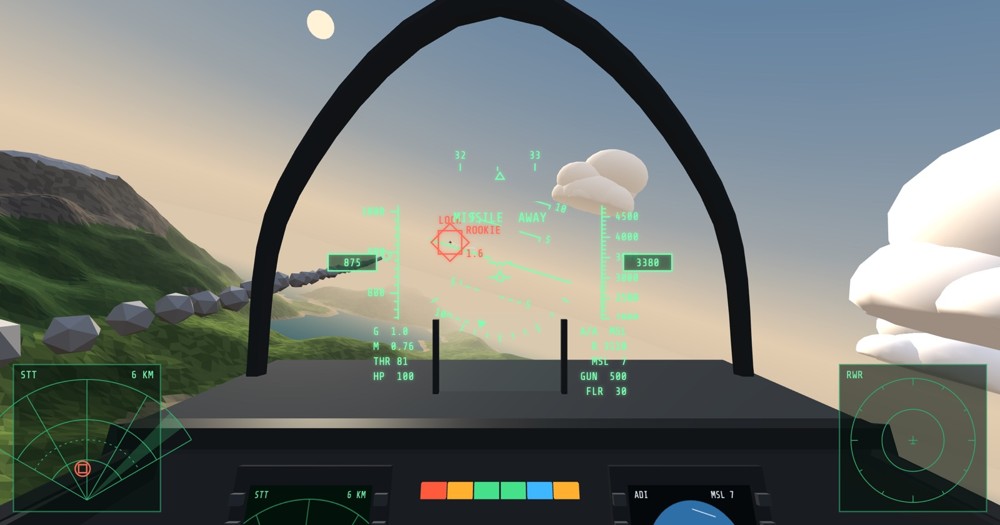

# CORNER VELOCITY

コックピットから敵機を追い、背後を取って撃ち落とす。ブラウザで無料で遊べるエアコンバットゲーム「CORNER VELOCITY」の、お問い合わせの窓口です。

- ゲームを遊ぶ：https://corner-velocity.online/
- 公式サイト：https://www.corner-velocity.online/

## 不具合の報告、要望・感想

Issue のフォームから送ってください。

- [不具合を報告する](https://github.com/tokiya-takai/www.corner-velocity/issues/new?template=bug.yml)：ゲームが動かない、表示や操作がおかしい、といったとき
- [要望・感想を送る](https://github.com/tokiya-takai/www.corner-velocity/issues/new?template=feedback.yml)：追加してほしい機能や、遊んだ感想

送る前に、次の点を確かめてください。

- 書き込むには、GitHub のアカウントが必要です。
- Issue は誰でも読めます。名前やメールアドレスなどの個人情報は書かないでください。
- 同じ内容の報告がすでにないか、[これまでの Issue](https://github.com/tokiya-takai/www.corner-velocity/issues) で確かめてください。同じ不具合が起きているときは、その Issue にコメントで端末やブラウザを書き足してもらえると、原因を絞り込みやすくなります。

## このリポジトリについて

公式サイトのソースも、このリポジトリに置いています。
